<div align="center">



<br/>


**Find a skilled worker nearby. Book them. Rate them. All in one place.**

[Source Code](https://github.com/deepakbharti-cloud/KaaryaSetu) · [Report an Issue](https://github.com/deepakbharti-cloud/KaaryaSetu/issues) · [Author](#author)

</div>

---

## 📑 Table of Contents

- [Overview](#overview)
- [Features](#features)
- [User Roles](#user-roles)
- [Workflow](#workflow)
- [Technology Stack](#tech-stack)
- [Project Structure](#project-structure)
- [Getting Started](#getting-started)
- [Roadmap](#roadmap)
- [Author](#author)

---

<a id="overview"></a>

## 📖 Overview

**Kaarya** means *work* and **Setu** means *bridge*. KaaryaSetu is a **hyperlocal labour marketplace** that connects local skilled workers (plumbers, electricians, carpenters, painters, cleaners, drivers, masons and cooks) with customers who need their services.

Customers browse categories, find a worker in their area, check the profile and reviews, and send a booking request. Workers manage those requests from their own dashboard. Admins verify workers and keep an eye on the platform.

---

<a id="features"></a>

## ✨ Features

| | Feature | What it does |
|---|---|---|
| 🔐 | **Role-based auth** | Separate signup and login for Customer, Worker and Admin |
| 🗂️ | **Categories & subcategories** | OLX-style "All Categories" mega menu for easy browsing |
| 🔎 | **Worker search** | Filter workers by category and area |
| 👷 | **Worker profiles** | Rate, bio, area and reviews on one page |
| 📅 | **Booking system** | Request, accept, complete and cancel bookings |
| ⭐ | **Ratings & reviews** | The worker's average rating updates automatically after each review |
| 📊 | **Role-based dashboards** | Customer bookings, worker requests and an admin overview |
| 📱 | **Responsive UI** | Built with Tailwind CSS |

---

<a id="user-roles"></a>

## 👥 User Roles

| Role | What they can do |
|---|---|
| 🧑 **Customer** | Browse categories, search workers, view profiles, book a service, leave a review |
| 👷 **Worker** | Create a profile, receive booking requests, accept and complete jobs |
| 🛡️ **Admin** | Verify workers, manage categories and view the platform overview |

---

<a id="workflow"></a>

## 🔁 Workflow

<div align="center">

</div>

| Step | Lane | What happens |
|:---:|---|---|
| 1 | 👷 Worker | Registers an account as a worker |
| 2 | 🛡️ Admin | Verifies the worker (`is_verified`) so they appear in the public listing |
| 3 | 🧑 Customer | Browses categories and searches by area |
| 4 | 🧑 Customer | Opens a worker's profile to check rate, bio and reviews |
| 5 | 🧑 Customer | Sends a booking request |
| 6 | 👷 Worker | Accepts the request from the dashboard |
| 7 | 👷 Worker | Marks the job as completed |
| 8 | 🧑 Customer | Leaves a rating and review, and the worker's average rating updates |

---

<a id="tech-stack"></a>

## 🛠️ Technology Stack

| Layer | Technology | Purpose |
|---|---|---|
| Language | Python | Core development |
| Backend | Django (plain Django, no DRF) | Routing, models, admin, server-side rendering |
| Database | SQLite (dev), MySQL planned for production | Data storage |
| Frontend | Django Templates, HTML5, Tailwind CSS (CDN), JavaScript | UI |
| Auth | Django session authentication with a custom User model | Login and roles |
| Version control | Git & GitHub | Source management |

---

<a id="project-structure"></a>

## 📁 Project Structure

```text
KaaryaSetu/
├── accounts/      # Custom User model, register / login / logout, role-based redirect
├── categories/    # Category & SubCategory models, navbar context processor
├── workers/       # WorkerProfile model, home page, listing, detail page
├── bookings/      # Booking model, booking flow, worker dashboard
├── reviews/       # Review model, rating logic
├── templates/     # Shared base template (navbar, mega menu, footer)
└── manage.py
```

---

<a id="getting-started"></a>

## 🚀 Getting Started

### 1. Clone the repository

```bash
git clone https://github.com/deepakbharti-cloud/KaaryaSetu.git
cd KaaryaSetu
```

### 2. Create a virtual environment (recommended)

**Windows (PowerShell):**

```powershell
python -m venv .venv
.\.venv\Scripts\Activate.ps1
```

**macOS / Linux:**

```bash
python3 -m venv .venv
source .venv/bin/activate
```

### 3. Install Django

```bash
pip install django
```

### 4. Run migrations

```bash
python manage.py migrate
```

### 5. Create an admin account

```bash
python manage.py createsuperuser
```

### 6. Start the server

```bash
python manage.py runserver
```

Open **http://127.0.0.1:8000/** for the app and **http://127.0.0.1:8000/admin/** for the admin panel.

> 💡 **Tip:** After creating a worker account, open the admin panel and tick `is_verified` for that worker. Only verified workers appear in the public listing. You can also add categories and subcategories from the admin panel.

---

<a id="roadmap"></a>

## 🗺️ Roadmap

- [x] Role-based signup and login (Customer, Worker, Admin)
- [x] Category and subcategory browsing with mega menu
- [x] Worker listing, search and profile pages
- [x] Booking flow (request, accept, complete, cancel)
- [x] Reviews with auto-updating average rating
- [x] Role-based dashboards
- [ ] Link workers to subcategories for exact filtering
- [ ] Worker profile photo upload
- [ ] Online payments (Razorpay) plus cash-on-service
- [ ] In-app chat or contact reveal after booking
- [ ] Location-based nearby search
- [ ] Migrate to MySQL and deploy

---

<a id="author"></a>

## 👨‍💻 Author

**Deepak Bharti**

- 🌐 Portfolio: [deepakbharti.github.io](https://deepakbharti.github.io)
- 🐙 GitHub: [@deepakbharti-cloud](https://github.com/deepakbharti-cloud)
- 💼 LinkedIn: [Deepak Bharti](https://www.linkedin.com/in/deepak-bharti-ab7622315)

---

<div align="center">

Built with Python and Django · ⭐ Star the repo if you like it!

</div>
